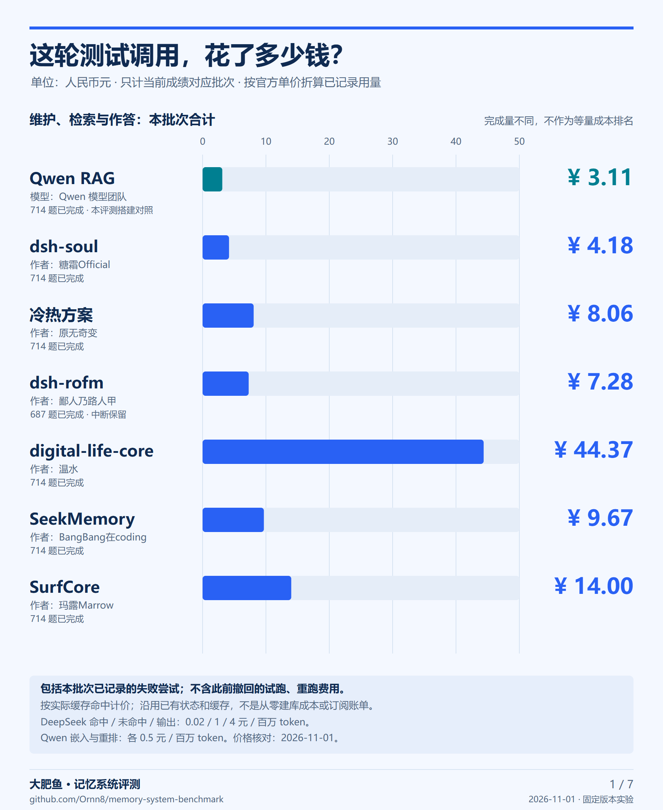
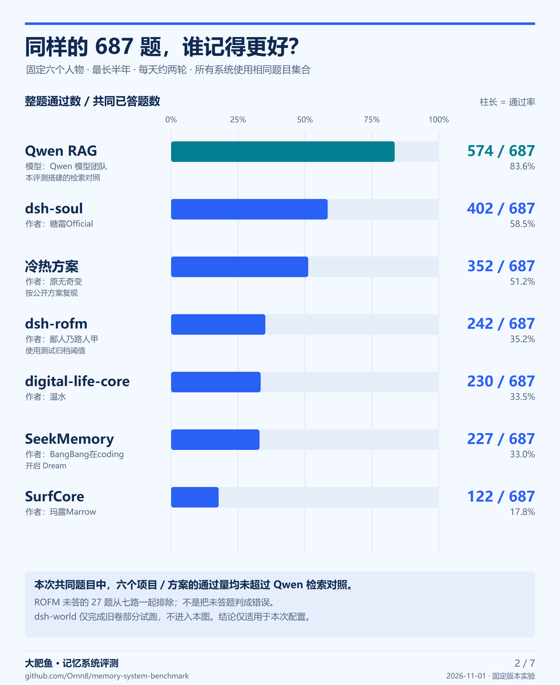
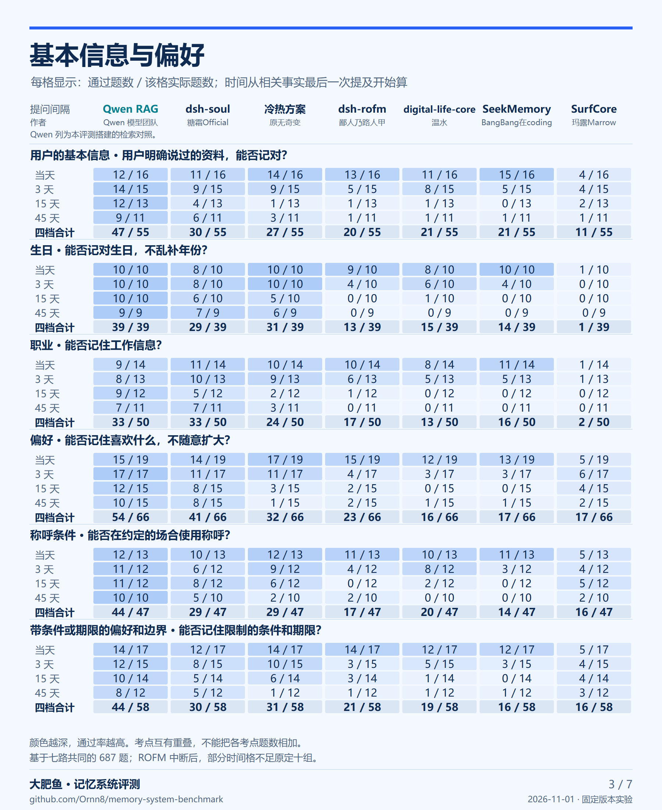
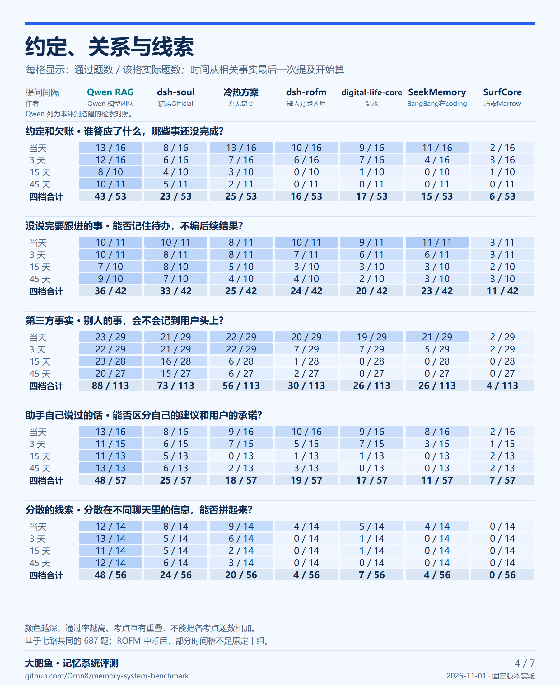
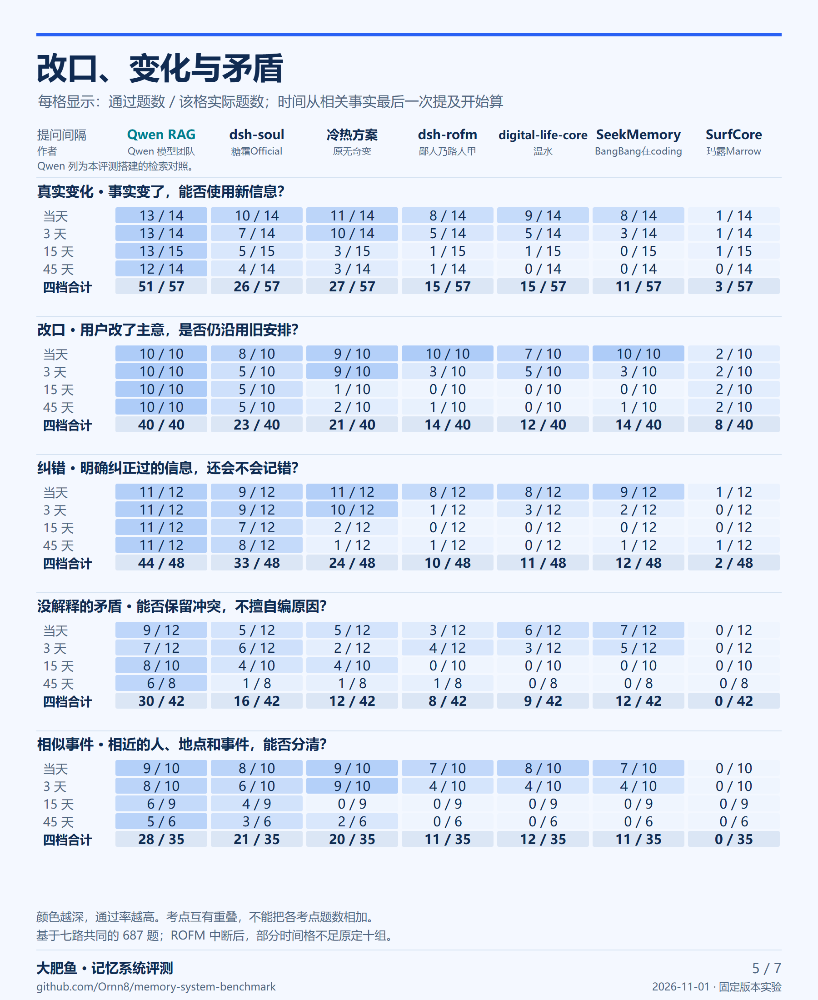
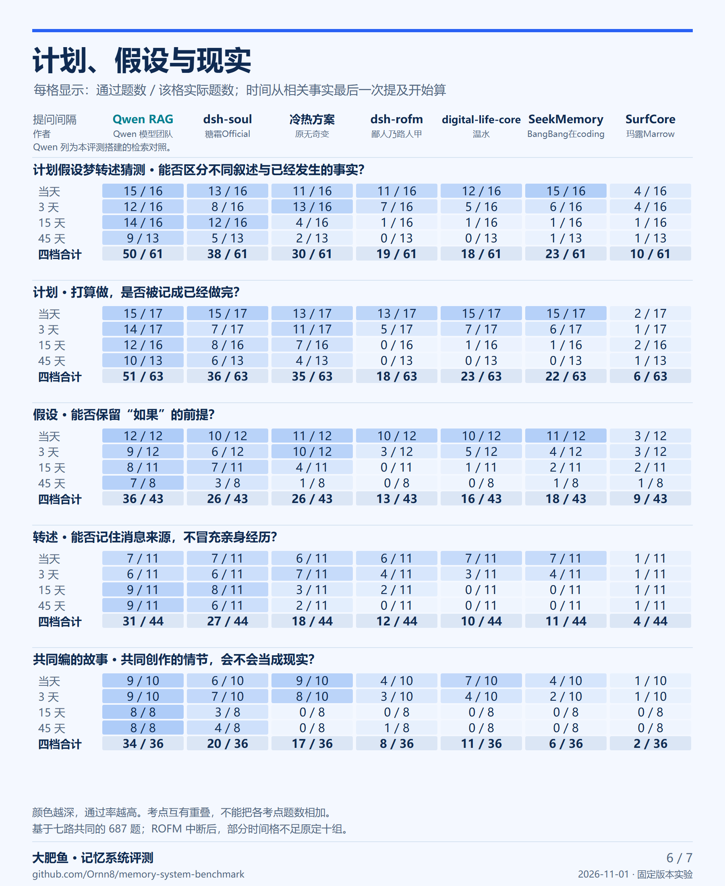
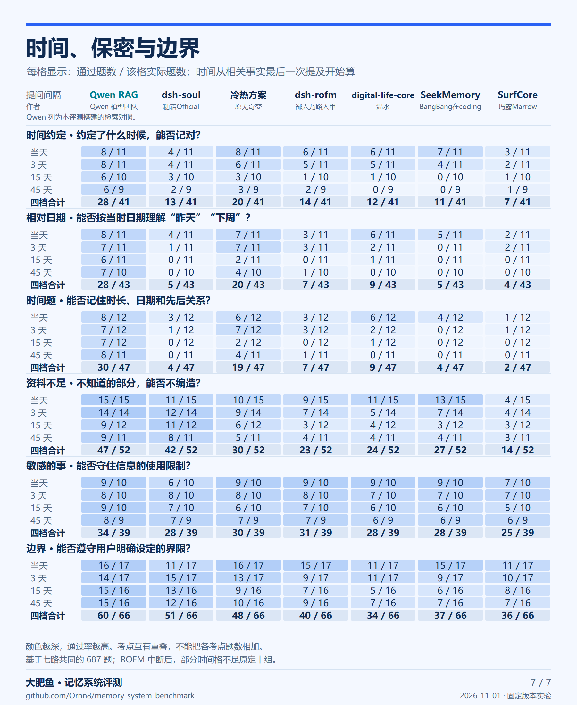

# 图片成绩单 · 2026-11-01

共 7 张 **1800 × 2200 PNG**，可直接用于图文或视频；同名 SVG 可无损放大。每张图均标注项目作者，Qwen 另注明模型团队与本评测搭建的对照流程。以下图片只包含汇总数字，不公开正式题目、答案或私人聊天。

| 图片 | PNG | 可编辑矢量图 |
| --- | --- | --- |
| 测试消费 | [01-cost.png](01-cost.png) | [SVG](01-cost.svg) |
| 总成绩 | [02-overall.png](02-overall.png) | [SVG](02-overall.svg) |
| 基本信息与偏好 | [03-topics.png](03-topics.png) | [SVG](03-topics.svg) |
| 约定、关系与线索 | [04-topics.png](04-topics.png) | [SVG](04-topics.svg) |
| 改口、变化与矛盾 | [05-topics.png](05-topics.png) | [SVG](05-topics.svg) |
| 计划、假设与现实 | [06-topics.png](06-topics.png) | [SVG](06-topics.svg) |
| 时间、保密与边界 | [07-topics.png](07-topics.png) | [SVG](07-topics.svg) |

## 数字怎么读

成绩统一取七路共同已答的 **687 题**。ROFM 中断后有 27 题未答，因此这 27 题在所有系统中一起排除；不是把未答算错。之前公布的完整 714 题结果保留在[前四路完整成绩](../../results/2026-11-01-first-four.md)及[新增三项目合辑](../../results/2026-11-01.md)。这次只重组已有判分，没有重新考试或改判。

考点图的每格是“通过题数 / 该格实际题数”。当天、3 天、15 天、45 天从相关事实最后一次提及开始算；时间间隔放在各考点内部。考点标签互有重叠，不能把它们相加当总题数。同一事实隔一段时间再问不等于新增独立事实。共同题子集排除了 ROFM 未答题，部分时间格不足原定十组，图中保留实际分母。

dsh-world 只有旧卷部分试跑结果，不加入这张新卷比较，也不写成零分。项目作者、固定版本、接入方式、维护开关与局限见[测试配置](../../docs/tested-configurations.md)。结论只适用于这里的固定配置和超轻度场景。

## 费用只计哪些

按用户选定范围，**只展示当前成绩对应批次**。各系统用对应执行起止、账本起始位置及系统标识划定范围，包含这一批已记录的维护、检索、作答及失败尝试，排除此前撤回的试跑和重跑。Soul、ROFM 采用限制直接聊天上下文后的保留批次，未混入早期完整上下文批次。

费用图统计整批，而成绩图使用共同题子集：除 ROFM 完成 687 题外，其余完成 714 题。图中列明完成量，**不把整批费用当作等量成本排名**。这些批次沿用已有状态和缓存，不是从零建立记忆库的全部费用，也不是订阅付款账单。缺少用量回执的调用不估造费用。

采用已记录的输入、缓存命中、输出 token 及官方人民币单价，不以订阅额度换汇。DeepSeek 使用 `deepseek-v4.1-flash`；所选调用按北京时间均在周末，对应官网空闲时段单价。2026-11-01 核对的价格如下：

| 模型与用量 | 元 / 百万 token |
| --- | ---: |
| DeepSeek：缓存命中输入 | 0.02 |
| DeepSeek：未命中输入 | 1 |
| DeepSeek：输出 | 4 |
| Qwen `qwen3.7-text-embedding`，北京 | 0.5 |
| Qwen `qwen3.7-text-rerank`，北京 | 0.5 |

价格来源：[DeepSeek 官方定价](https://api-docs.deepseek.com/zh-cn/quick_start/pricing/)、[阿里云百炼模型定价](https://help.aliyun.com/zh/model-studio/model-pricing)。这是本次核对的价格快照，官网之后可能调整。

计算式：`(未命中输入 × 1 + 命中输入 × 0.02 + 输出 × 4) / 1,000,000`，再加 Qwen 嵌入和重排费用。Qwen RAG 合计同时包含检索及 DeepSeek 作答。不同系统的原生工具链会把检索记入不同阶段，所以不把“作答阶段”拆出来冒充完整成本。

## 汇总数据与重画

[data.json](data.json) 提供通过数、实际分母、各考点时间格、批次用量与对应来源哈希，不包含正式题号、题面、原始答卷或私有账本。它能复算图中数字，不能代替尚未公开的正式实验端到端复现。

从仓库根目录生成 SVG，只需 Python 3.10 或更新版本：

```sh
python tools/render_charts.py --svg-only
python -m unittest discover -s tests -v
```

生成 PNG 另需 Playwright 和浏览器；本次使用 Windows 的 Microsoft Edge 与微软雅黑字体：

```sh
python -m pip install playwright
python tools/render_charts.py --channel msedge
```

也可安装 Playwright Chromium 后不传 `--channel`；需自行提供中文字体。字体差异可能改变排版，脚本会检查文字边界与相互遮挡。已经提交的 PNG 无需安装任何工具即可查看。

## 图片预览














