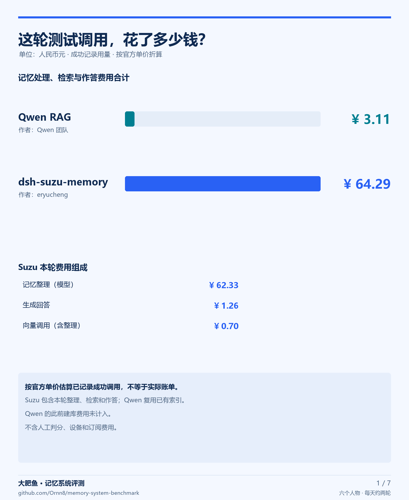
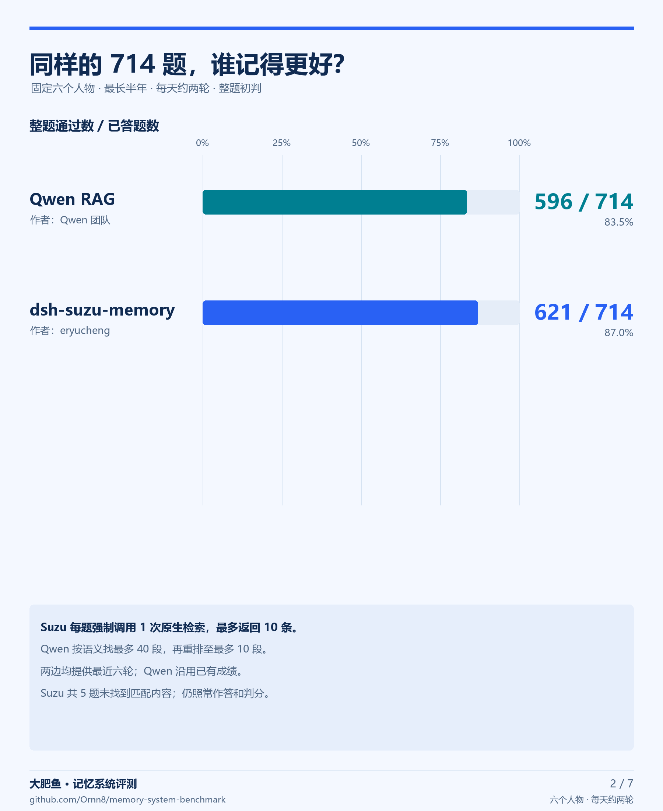
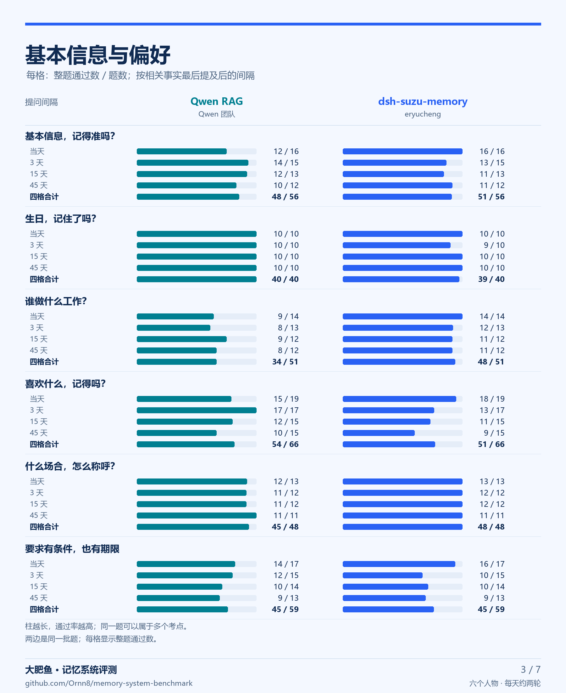
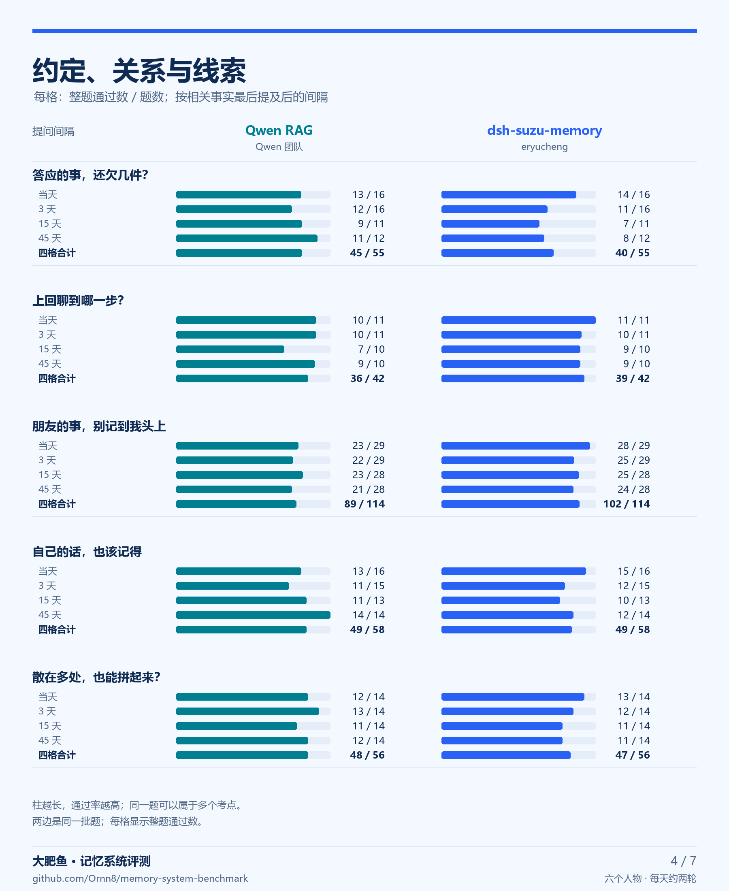
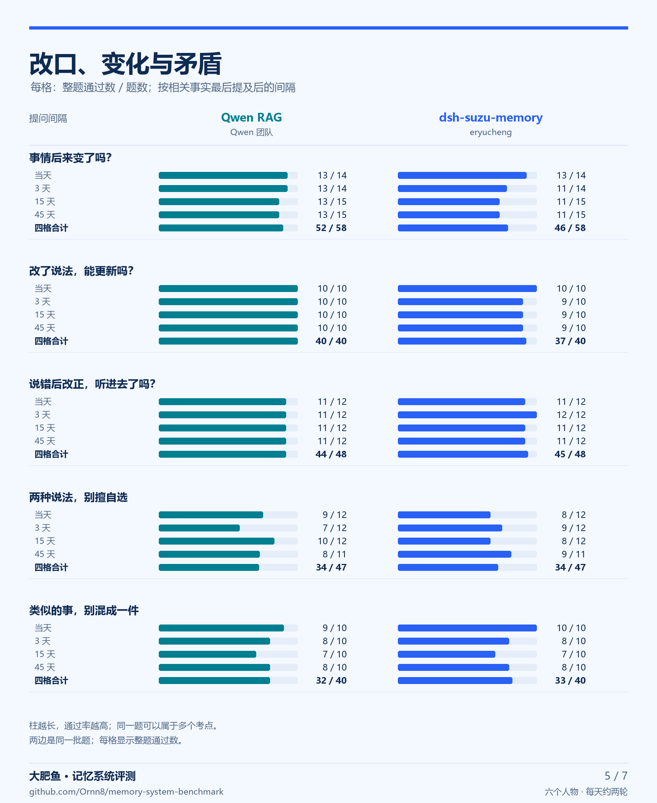
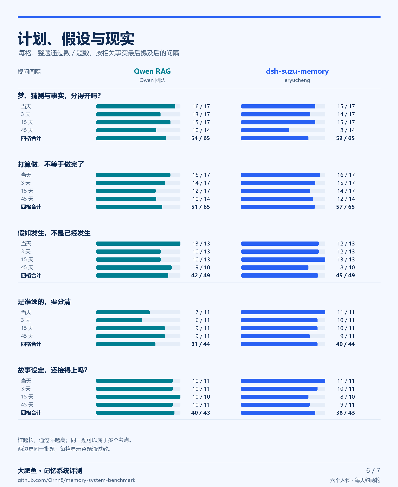
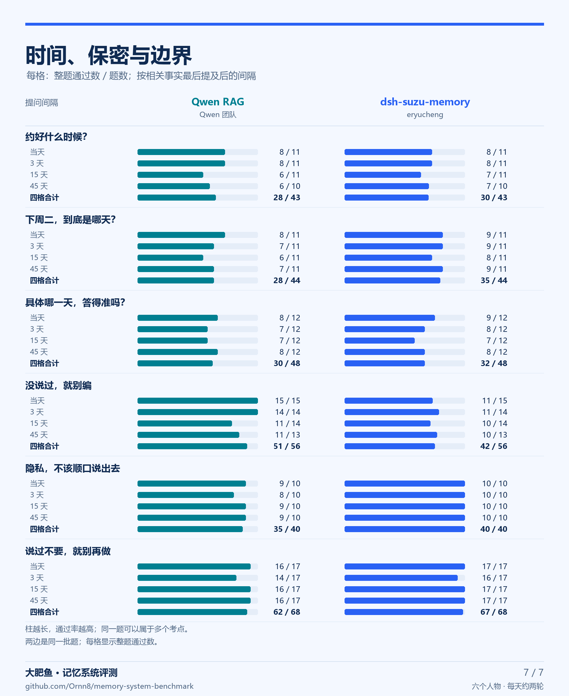

# Suzu 强制原生检索重测 · 七张图

Suzu 强制原生检索与既有 Qwen RAG 对照；同一六人物、714 题，成绩为初判。

1. 测试消费
2. 总成绩
3. 基本信息与偏好
4. 约定、关系与线索
5. 改口、变化与矛盾
6. 计划、假设与现实
7. 时间、保密与边界

[查看成绩与测试配置](../../results/2026-11-05-suzu-forced.md)
